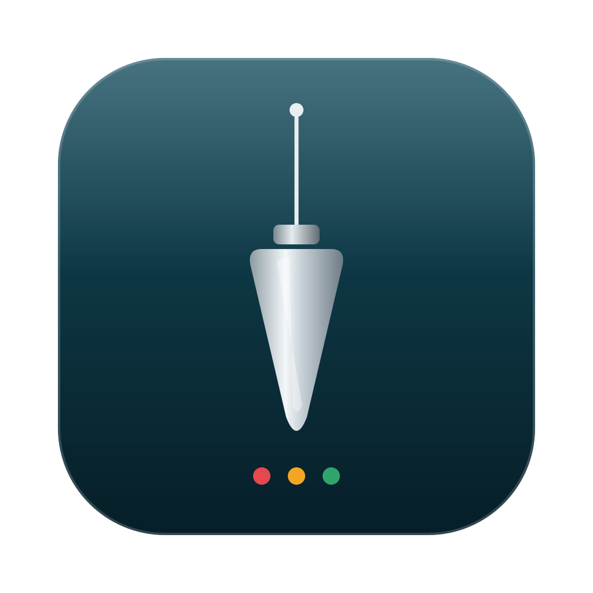
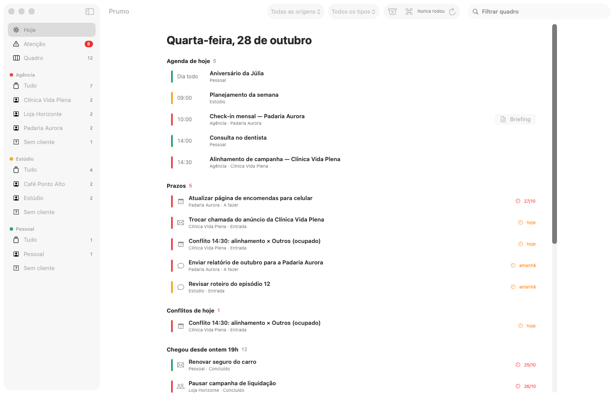
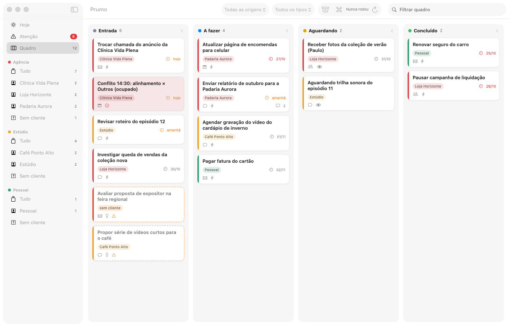
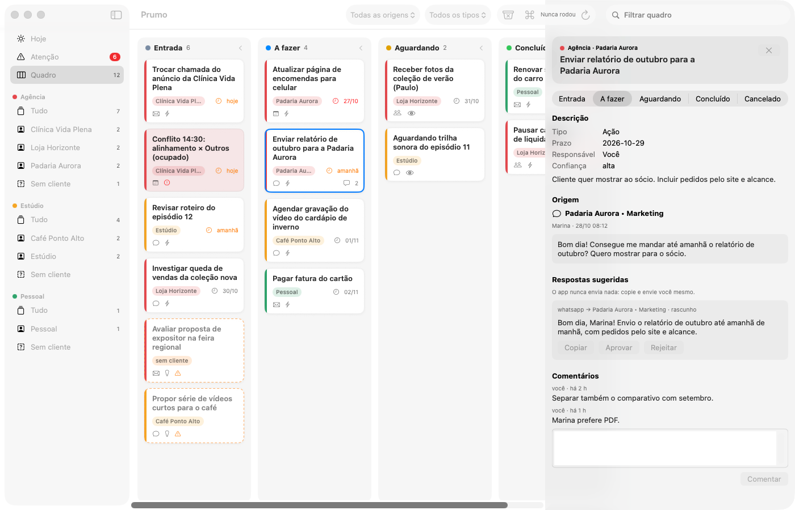
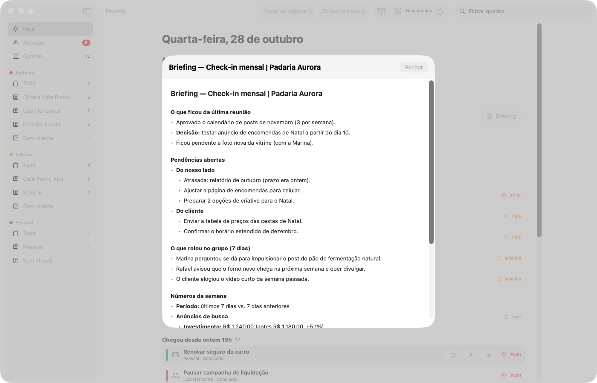
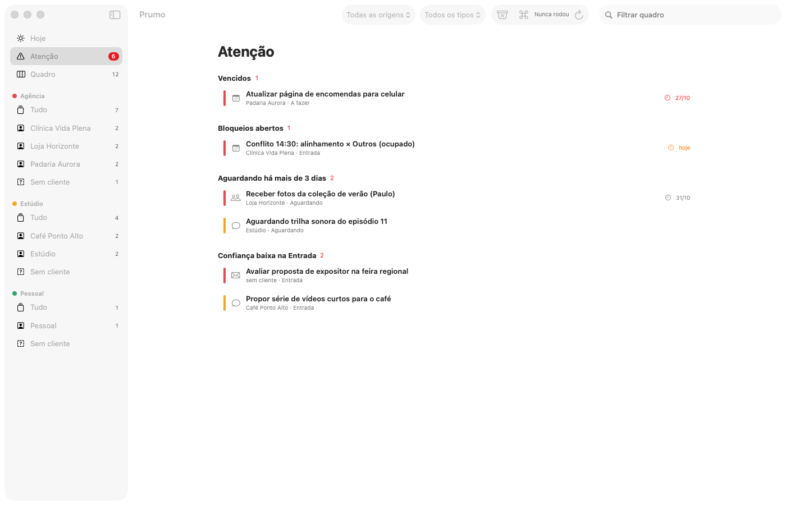
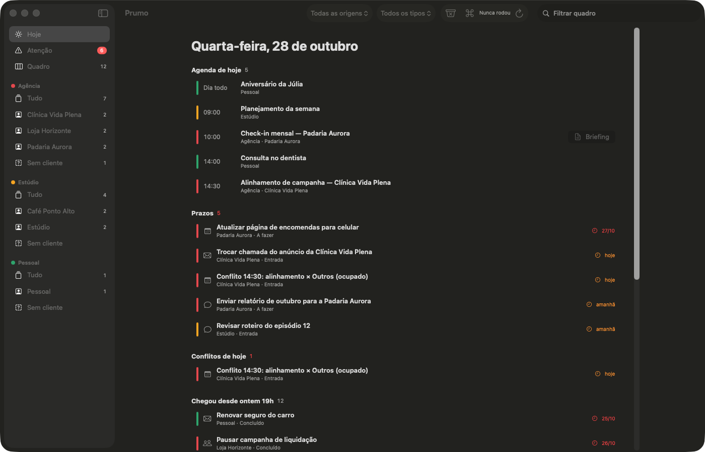

<p align="center">
  
</p>

<h1 align="center">Prumo</h1>

<p align="center">
  Assistente pessoal de rotina para macOS: lê o que chega no e-mail, na agenda, nas reuniões e nos grupos de WhatsApp,
  transforma em tarefas por cliente e mantém o seu dia no prumo.<br>
  <b>Ele só lê e sugere. Nunca envia nada por você.</b>
</p>

<p align="center">
  
</p>

> Todas as imagens usam um banco de demonstração com empresas e pessoas fictícias (`docs/demo/criar_demo.py`).

## O que ele faz

| | |
|---|---|
| **Hoje** | Agenda das suas contas, prazos vencidos/hoje/amanhã, conflitos de horário, o que chegou desde ontem às 19h e o que está parado há mais de 3 dias. |
| **Quadro** | Kanban (Entrada → A fazer → Aguardando → Concluído / Cancelado). Arrastar entre colunas, ⌘1–⌘4 para mudar o estado, ⌘K para achar qualquer tarefa. |
| **Atenção** | Vencidos, travados e o que espera resposta há dias. |
| **Briefing** | Antes de cada reunião com cliente: pendências dos dois lados, o que ficou da última reunião, o que rolou no grupo, números da semana (Google Ads/GA4) e pauta sugerida. |
| **Resumo das 07h** | Notificação com compromissos, prazos e conflitos do dia. |
| **Rascunhos** | Sugere respostas quando alguém espera um retorno seu. Você copia, aprova ou rejeita — não existe botão de enviar. |
| **Áudios** | Transcreve áudios de WhatsApp localmente (faster-whisper). |

<p align="center">
  
</p>

<p align="center">
  
  
</p>

<p align="center">
  
  
</p>

## Como funciona

```
 Gmail ─┐                                    ┌─ Hoje
 Agenda ┼─ coletar.py ─ classificar.py ─ SQLite ─┼─ Quadro / Atenção      (app SwiftUI)
 Meet   │   (só leitura)   (claude -p,        │   └─ Briefing
 (Gemini)│                 1 ambiente/vez)    │
 WhatsApp┘                                    └─ briefing.py (Google Ads/GA4, só consulta)
                 rodada.sh · launchd · seg–sex 07h–19h, de hora em hora
```

- **Ambientes separados.** Você define as frentes da sua vida (ex.: "Agência", "Minha empresa", "Pessoal"). Um cliente de um ambiente nunca aparece no outro: o banco recusa (chave estrangeira ambiente+cliente) e cada chamada ao Claude vê um ambiente só. Nos conflitos de agenda, o compromisso do outro ambiente aparece só como "Outros (ocupado)".
- **Só leitura em duas camadas.** O login do Google pede apenas `gmail.readonly`, `calendar.readonly` e `documents.readonly`, e o código recusa qualquer token com escopo a mais. Os conectores MCP rodam com `--read-only`.
- **Nada é enviado.** Um rascunho só muda para "enviado" com aprovação registrada (trigger no banco) — e o app nem tem esse botão.
- **Tudo auditado.** Cada mudança de estado, comentário e aprovação vai para uma tabela de auditoria que não aceita alteração nem exclusão.
- **Rastreável.** Todo card aponta para a mensagem, e-mail, evento ou anotação de reunião que o originou.
- **Seus dados ficam no seu Mac.** `cadastro/`, o banco e os áudios estão no `.gitignore`.

## Instalar

Pré-requisitos: macOS 15+ (o visual Liquid Glass aparece no macOS 26), [Claude Code](https://claude.com/claude-code), Homebrew e uma conta Google por ambiente.

```bash
git clone https://github.com/ckpsantos/prumo.git
cd prumo
claude
```

No Claude Code, digite:

```
/instalar-prumo
```

O Claude verifica as dependências, te entrevista (ambientes, e-mails, clientes, grupos), guia a criação do acesso no Google Cloud e os logins só-leitura, configura o WhatsApp se você quiser, compila o app e prepara as rodadas automáticas. Os passos que deixam algo rodando no seu Mac ele mostra para **você** executar.

<details>
<summary>Instalação manual</summary>

```bash
./instalar.sh verificar      # dependências
./instalar.sh preparar       # cria cadastro/ a partir de cadastro.exemplo/ e o banco
# edite cadastro/config.json e crie o cliente OAuth "App para computador" de cada conta (ver a skill)
./instalar.sh google <ambiente>   # login só-leitura + teste
./instalar.sh mcp            # .mcp.json com os conectores só-leitura
./instalar.sh app            # compila e instala /Applications/Prumo.app
MANUAL=1 ./rodada.sh         # primeira coleta
./instalar.sh agenda         # gera o agendamento e mostra o comando para ligar
```
</details>

## Configuração

Tudo o que é seu fica em `cadastro/` (veja `cadastro.exemplo/`):

- `config.json` — ambientes (nome, cor, e-mail, filtros, reuniões e briefing ligados), clientes e os termos que identificam cada um no título das reuniões.
- `whatsapp_autorizados.json` — os **únicos** grupos de WhatsApp lidos.
- `<ambiente>/<cliente>.md` — contexto do cliente em texto livre para o Claude.

## Limitações e avisos

- **WhatsApp:** usa a ponte não oficial [whatsapp-mcp-plus](https://github.com/AllissonOliveira/whatsapp-mcp-plus) (WhatsApp Web). Não é API oficial; a sessão pode cair e o WhatsApp pode restringir contas que usam clientes não oficiais. Use por sua conta e risco. Para um segundo número há o patch `conectores/whatsapp/multinumero.patch`.
- **Google em modo teste:** se o seu app OAuth estiver em "Testando", o Google derruba o login a cada 7 dias (é só logar de novo). Publicar evita isso, mas exige página inicial e política de privacidade.
- **Reuniões:** só entram anotações do Gemini anexadas ao evento e às quais você tem acesso. Anotações de reuniões organizadas por outras pessoas e não compartilhadas ficam de fora.
- **Mac ligado:** as rodadas rodam via launchd; com o Mac dormindo, a rodada daquele horário não acontece.
- **Custo:** a classificação e o briefing usam o `claude -p` da sua assinatura do Claude.

## Estrutura

```
app/                SwiftUI (SwiftPM, sem Xcode, sem dependências) + ícone
cadastro.exemplo/   modelo da sua configuração (a real fica em cadastro/, fora do Git)
conectores/         Google só-leitura, transcrição, patch do WhatsApp
db/                 schema SQLite + init com autoteste (python3 db/init.py --teste)
design/             referências de design (Liquid Glass, Kanban, apps SwiftUI)
docs/               imagens do README e gerador do banco de demonstração
.claude/skills/     /instalar-prumo
coletar.py · classificar.py · briefing.py · resumo_dia.py · rodada.sh · instalar.sh
```

## Licença

MIT. A ponte de WhatsApp é um projeto separado, também MIT.
